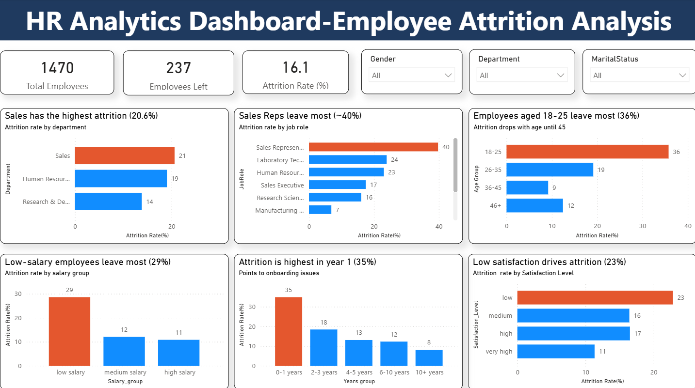

# HR Employee Attrition Analysis

**Tools:** Power BI, DAX
**Dataset:** [IBM HR Analytics Employee Attrition](https://www.kaggle.com/datasets/pavansubhasht/ibm-hr-analytics-attrition-dataset) – 1,470 employees (fictional data created by IBM for learning)

## Business question
Why do employees leave the company, and which groups are most at risk?

## What I did
- Created **DAX calculated columns** to group employees by age, years at company, salary and job satisfaction, with sort-order columns so charts display in the correct order.
- Built an **Attrition Rate %** measure and used **rates instead of counts**, so departments and roles of different sizes can be compared fairly.
- Added slicers for gender, department and marital status, and tooltips showing the number of employees who left.

## Dashboard

## Key insights
- **237 of 1,470 employees left**, an attrition rate of **16.1%** (about 1 in 6).
- **Sales** has the highest attrition by department (**20.6%**).
- **Sales Representatives** are the highest-risk role, at about **40%**, more than double the company average.
- Employees aged **18–25** leave the most (**36%**).
- Attrition is highest in the **first year** at the company (**35%**), pointing to onboarding issues.
- **Low-salary** employees (**29%**) and employees with **low job satisfaction** (**23%**) are much more likely to leave.

**Recommendation:** focus retention efforts on young, new and lower-paid employees, especially in Sales roles, through better onboarding, pay reviews and engagement.
