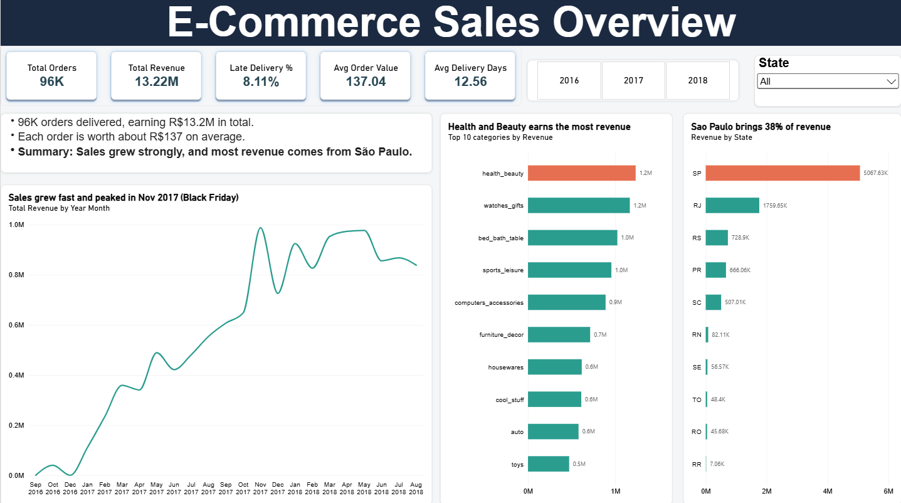
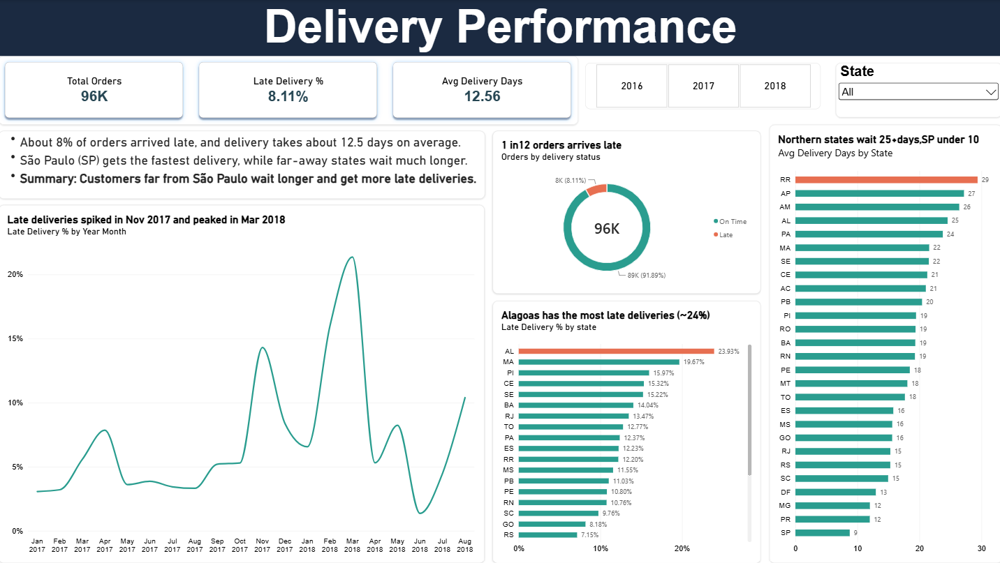

# E-Commerce Sales & Delivery Analysis

**Tools:** PostgreSQL (pgAdmin 4), SQL, Power BI
**Dataset:** [Brazilian E-Commerce Public Dataset by Olist](https://www.kaggle.com/datasets/olistbr/brazilian-ecommerce) – real, anonymised orders from a Brazilian online marketplace (2016–2018)

## Business questions
1. How much revenue does the business make, and how is it growing?
2. Which product categories and states bring the most revenue?
3. How often are orders delivered late, and where?

## What I did
- Created 5 tables in PostgreSQL and imported the CSV files (99K+ orders, 112K+ order items), then validated row counts.
- Wrote SQL queries using **JOINs, GROUP BY, CASE WHEN and date functions** to analyse revenue, categories, states and delivery times.
- Built a SQL **view** (`order_details`) joining all tables, with calculated **delivery status** (Late / On Time) and **delivery days**.
- Connected Power BI directly to PostgreSQL and built a 2-page dashboard. Used `DISTINCTCOUNT` so orders with several items are counted once.
- Checked that Power BI totals matched the SQL results exactly.

## Dashboard

### Page 1 – Sales Overview

### Page 2 – Delivery Performance

## Key insights
- **96K delivered orders** generated **R$13.2M** in revenue, with an average order value of **R$137**.
- Sales grew strongly through 2017 and **peaked in November 2017 (Black Friday)**.
- **São Paulo** alone brings about **38% of revenue**.
- **Health & Beauty** is the top category by revenue.
- About **8.1% of orders arrive late** (roughly 1 in 12), and delivery takes about **12.6 days** on average.
- Late deliveries **spiked in November 2017 (about 14%)** and **peaked in March 2018 (about 21%)**, showing the delivery network struggled in busy periods.
- **Alagoas (AL)** has the highest late-delivery rate (about 24%). **Northern states** wait **25+ days**, while São Paulo gets orders in **under 10 days**.

**Recommendation:** improve delivery to north and northeast states (regional warehouses or better carrier partners), and plan extra delivery capacity for busy periods such as Black Friday and early-year peaks.

## Files
- `SQL/` – table creation, analysis queries and the `order_details` view
- `Datasets/` – the 5 CSV files used
- `Dashboard/` – Power BI file (.pbix)
- `Screenshots/` – dashboard images
