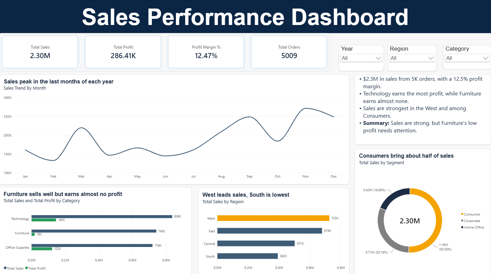
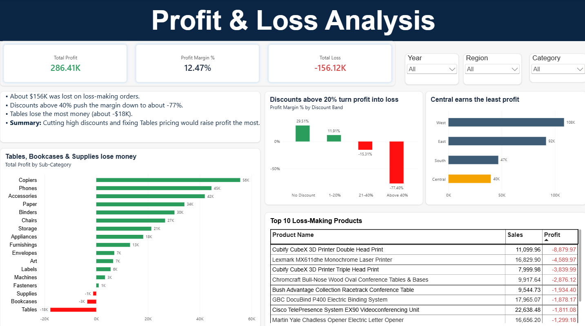

# Sales Performance & Profit Analysis

**Tools:** Excel, Power BI (DAX)
**Dataset:** Sample Superstore – 9,994 retail orders (2014–2017) with sales, profit, discount, category and region

## Business questions
1. How are sales and profit performing overall?
2. Which categories, regions and customer segments drive sales?
3. **Where is the company losing money, and why?**

## What I did
- **Excel:** checked for blanks, removed duplicate rows (9,994 → 9,993), and built a pivot table to validate sales by region.
- **Power BI:** created a date table and DAX measures for **Total Sales, Total Profit, Profit Margin %, Total Orders and Total Loss**.
- Added a **Discount Band** calculated column (No Discount, 1–20%, 21–40%, Above 40%) to study how discounts affect profit.
- Built a 2-page dashboard with insight-based chart titles, green/red profit-loss colours and conditional formatting.

## Dashboard

### Page 1 – Sales Overview

### Page 2 – Profit & Loss Analysis

## Key insights
- **$2.3M** in sales from **5,009 orders**, with **$286K profit** and a **12.5% profit margin**.
- **Technology** earns the most profit, while **Furniture** earns only **$18K profit on $742K sales**.
- **West** leads sales and **Consumers** bring about half of all sales.
- **Discounts above 20% turn profit into loss.** Above 40% discount, the profit margin falls to about **-77%**.
- **Tables, Bookcases and Supplies** are the loss-making sub-categories, with Tables losing the most (about **-$18K**).
- Loss-making orders add up to about **$156K** in losses.

**Recommendation:** cap discounts at 20%, and review pricing and costs for Tables and Bookcases.
